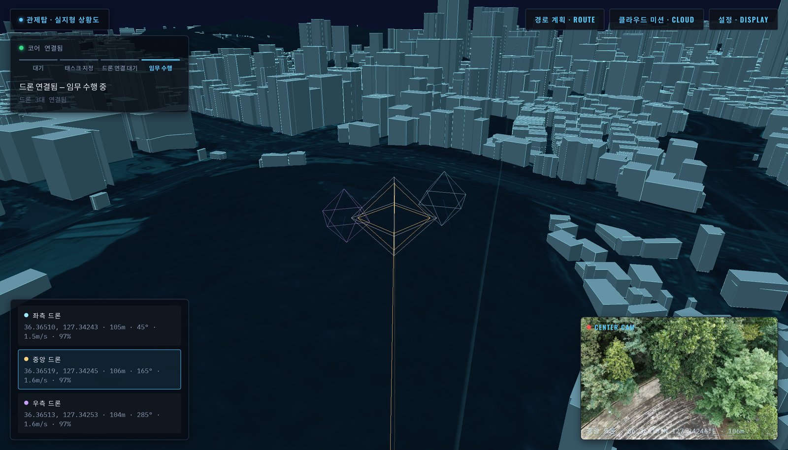
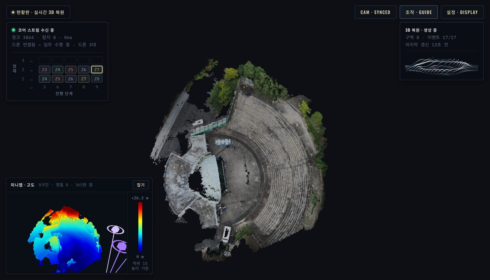
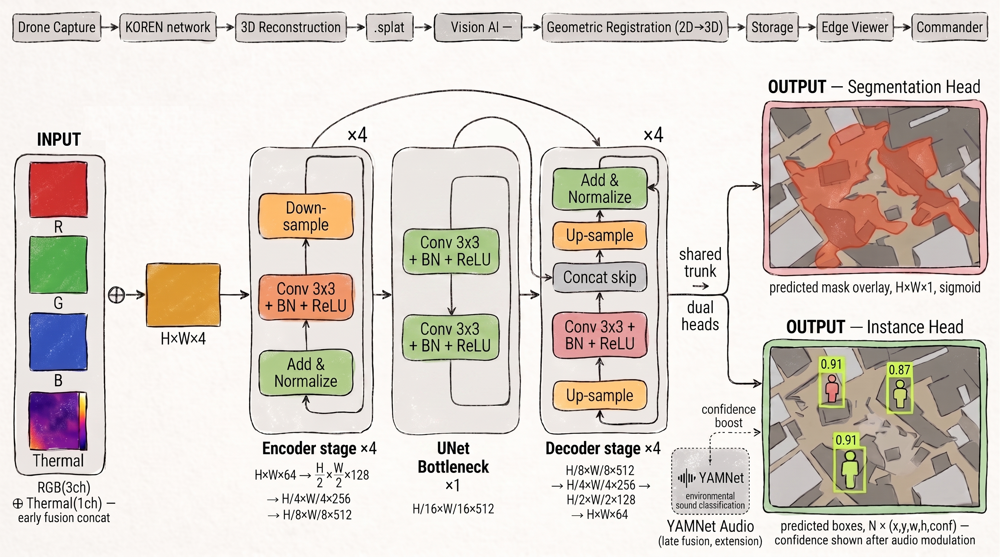

<div align="center">

# 🛸 SkyLens

**멀티드론 영상을 실시간 3D로 복원하고, 그 위에 AI가 위험구역·사람을 표시하는 재난 인텔리전스 플랫폼**

*NET 챌린지 캠프 시즌13*

<br/>


</div>

---

## 개요

SkyLens는 여러 대의 드론이 재난 현장을 분할 탐색하며 보낸 영상을 고속망으로 모아 **현장을 실시간 3D 점군·메시로 복원**하고([cumulus3d](https://github.com/AH100-1/cumulus3d) 라이브 복원 + [deltamesh](https://crates.io/crates/deltamesh) 증분 메시), 같은 영상에 **AI를 돌려 위험구역·사람을 감지**해 3D 현장 위에 마커로 얹는 재난 대응 시스템입니다.

이 저장소는 파이프라인 전체를 컴포넌트로 나눠 담고 있습니다. 드론 → 게이트웨이 → 프록시 → 코어 → (모델 API · 관제탑 · 현황판). 구성과 각 컴포넌트의 책임은 **[COMPONENTS.md](https://github.com/NET-Challenge-S13/skylens/blob/develop/docs/COMPONENTS.md)가 단일 출처**입니다.

운영자가 보는 화면은 둘이고, **서로 직접 연결되지 않습니다.** 둘 사이에는 파이프라인 전체가 놓입니다:

- **관제탑**: 오퍼레이터가 **실제 GPS로 드론 경로를 지정**하는 화면. VWorld 실지형 위에 드론의 실제 텔레메트리를 그리며, 건물 표시를 점·검정 텍스처·실사 항공뷰 중에서 고를 수 있습니다. 코어가 서빙합니다.
- **현황판**: 드론이 지나간 **구간부터** 서버가 복원 결과를 보내옵니다. 구간은 정제본으로 한 번 보이면 제자리에 있고(stable display), 점은 바뀐 것만(추가·이동·제거) 점 슬롯 차분으로 흘러옵니다. 앞 구간이 정제되는 동안 다음 구간의 프레임이 쌓이므로 비행을 따라 지도가 자라납니다. 브리지(파이) nginx가 서빙합니다.



**관제탑.** VWorld 실지형 위에 건물이 입체로 서고, 드론 세 대가 각자의 색으로 그려집니다. 왼쪽 위는 미션 단계(대기 · 태스크 지정 · 드론 연결 대기 · 임무 수행), 왼쪽 아래는 드론마다 위치 · 고도 · 방위 · 속도 · 배터리, 오른쪽 아래는 고른 드론의 카메라 영상입니다. `경로 계획 · ROUTE`에서 웨이포인트를 찍어 배정합니다.



**현황판.** 드론 영상으로 복원한 현장(데모 촬영본, 야외 공연장)이 가운데에 쌓입니다. 왼쪽 위 서버 패널은 연결 상태와 받은 청크 · 탐지 수, 그리고 구역마다 미리보기 → 정제가 어디까지 왔는지 보여 주는 진행 단계 격자(딜레이 패턴)입니다. 오른쪽 위는 생성 중 표시, 왼쪽 아래는 높이 색 미니맵과 드론 위치입니다. 설정에서 메시 · 점 표시, 점 크기와 색, 메시 음영, 클래스별 확신도 기준(사람 80 · 화재 60 · 붕괴 60 · 도로 차단 70%)을 바꿉니다. 새 탐지가 오면 카메라가 그 지점으로 다가가고, 확인하면 원래 시점으로 돌아옵니다.

두 화면은 같은 코드로 웹, Windows · macOS · Linux 데스크톱 앱으로 돌고, 현황판은 Android 앱도 있습니다. 앱은 [릴리스](https://github.com/NET-Challenge-S13/skylens/releases/latest)에서 받습니다.

> 📄 기획·설계: [INTENT.md](docs/INTENT.md) · [ARCHITECTURE.md](docs/ARCHITECTURE.md) · [PROJECT.md](PROJECT.md)

---

## AI 모델



RGB 3채널과 열화상 1채널을 입력단에서 합친 4채널 UNet 하나(인코더 4단 · 병목 · 디코더 4단, 스킵 연결)에 헤드 둘을 답니다. **분할 헤드**는 위험구역(화재 · 붕괴 · 도로 차단)을 영역으로, **사람 헤드**는 사람마다 중심점과 확신도를 냅니다. 소리(YAMNet)로 확신도를 보정하는 경로는 확장입니다. 위 그림 맨 윗줄의 파이프라인(`.splat`)은 처음 3DGS 설계 기준이고, 지금 복원은 cumulus3d · deltamesh입니다.

프레임마다의 결과는 복원된 점에 투영해 현장 전체에 하나뿐인 ENU 지도에 쌓습니다. 가려진 면은 증거를 받지 않고, 한 드론의 2초 안 프레임은 한 번 본 것으로 치며, 서로 다른 시점 두 번 이상에서 봐야 보고합니다. 채택 모델(research v6) 기준 사람 재현율 0.86(정밀도 0.5), 붕괴 IoU 0.74, 도로 차단 IoU 0.42, 화재 IoU 0.48입니다. 설계 근거는 [`src/skylens_model/README.md`](src/skylens_model/README.md).

---

## 데모 모드 vs 실운영

데모에서도 **컴포넌트는 전부 실제 코드**입니다. 한 대의 머신에서 재현할 수 없는 기체 쪽(촬영·비행·경로)만 바뀝니다.

| | 실운영 | 데모 |
|---|---|---|
| 촬영 | 기체 카메라 → SRT | 실제 촬영본(DJI FC9589, 릴리스 `demo-footage-v1`에서 자동으로 받음)을 SRT로 송출. 기본은 첫 비행 약 53초, `--full-footage`면 2차까지 |
| 비행 | DJI Fly 웨이포인트 | 촬영본에 기록된 GPS·고도·방위를 영상과 맞춰 재생 |
| 경로 계획 | 운용자가 지도에서 지정 | 촬영 경로가 관제탑 경로 계획에 미리 들어가 있고, 운용자는 배정만 누름 |

복원·탐지·메시·배포는 데모에서도 실제 경로입니다. 영상 → 코어 프레임 추출 → 모델 서버(gRPC, V100) → 점·메시·탐지 청크 → 코어 → 관제탑·현황판. 파이프라인이 없으면 **없다고 표시**하고(`PipelineUnavailable`) 시뮬레이션으로 메우지 않습니다.

`cargo run -p skylens-demo -- --online`은 같은 런처를 **KOREN 실배치 위에서** 돌립니다. 영상은 브리지(파이) MediaMTX로, 드론 시뮬레이터는 대전 코어로 붙고 이 머신에서는 아무것도 띄우지 않습니다(VPN 필요). 영상은 피드마다 2500 kbps로 재인코딩해 VPN 상행을 아낍니다. 자세한 옵션은 [`src/demo/README.md`](src/demo/README.md).

---

## 좌표계 (GPS ↔ ENU ↔ 씬)

실세계 GPS를 1급 좌표계로 씁니다([`src/shared/geo.rs`](src/shared/geo.rs), 파이썬 짝은 `src/skylens_model/utils/geo.py`):

- 작전 구역의 기준 GPS(`SKYLENS_CORE_SITE`)를 원점으로 하는 **로컬 ENU(동/북/상) 미터** 프레임이고 1 unit = 1 m 입니다.
- 드론 경로는 **GPS로 지정** → ENU → 씬으로 변환. 탐지 결과도 **GPS로 수신** → 씬 좌표로 변환해 마커 배치.
- 복원 구간은 cumulus3d가 GPS 위치 제약으로 ENU에 놓습니다. 같은 구간 번호는 항상 같은 공간 조각이고, 한 번 보인 구간은 움직이지 않습니다.

---

## 빠른 시작

```bash
cargo build --workspace                 # Rust: shared · drone · model · client · demo · test
(cd src/skylens_core && go build ./...) # Go 코어
uv sync && uv run pytest                # Python: UNet 학습 코드
```

| 명령어 | 설명 |
|---|---|
| `cargo run -p skylens-demo` | 전 컴포넌트를 이 머신에서 띄우는 데모 런처 |
| `cargo run -p skylens-demo -- --online` | 실배치(브리지·대전·판교) 위에서 데모 |
| `cargo test --workspace` / `cargo clippy --workspace --all-targets` | Rust 테스트 / 린트 |
| `go test ./...` (`src/skylens_core`) | Go 테스트 |

앱만 쓸 때는 빌드할 필요 없이 [릴리스](https://github.com/NET-Challenge-S13/skylens/releases/latest)의 실행 파일(Windows · macOS · Linux, 현황판 Android APK)을 받습니다. 서명은 없습니다.

Rust 1.99 이상, 웹 화면은 `wasm32-unknown-unknown` 타깃. 모델 서버의 UNet은 `tch`(libtorch, 빌드 때 내려받음)이고 cumulus3d는 crates.io 릴리스(0.11)를 그대로 씁니다.

---

## 라이브 복원 (현황판)

복원은 촬영이 끝난 뒤 한 번에 처리하는 방식이 아니라, 드론이 지나간 **구간**(zone)에 프레임이 차면 그 구간을 정제해 내보냅니다. 트리거는 시간이 아니라 들어온 프레임입니다.

- **점**은 cumulus3d stable display의 표시 델타를 점 슬롯 차분(`slot_kind` 1 refined · 2 replace · 3 final · 4 preview)으로 보냅니다. 화면용으로 둘에 하나만 남기고(`SKYLENS_LIVE_STRIDE` 2), 구간 겹침은 지웁니다.
- **메시**는 deltamesh가 합성된 표시에서 바뀐 블록만 내보냅니다.
- **탐지**(UNet, 위험구역·사람)는 프레임마다 돌고 카메라 포즈로 점군에 투영해 GPS 기준 ENU 마커로 나갑니다.
- 모델 기본값: stride 2, 구간 미리보기 켬, 구간 크기 4, 메시 0.1 m, 백로그 묶음 끔(batch 1), 특징 선행 4, 내장 카메라 DJI FC9589(fx 1505 · fy 1510). 묶음을 끈 이유는 cumulus3d 0.11.0에서 batch > 1이 V100 라이브 축척을 약 30배 줄였기 때문입니다(원인 미확인, cumulus3d 0.11.1이 노드 기본값을 1로 바꿈).

KOREN 실배치 실측(드론 3대, 각 53초 분량, SRT 드론당 2.5 Mbps): 송출 시작 후 22.1초에 첫 프레임 묶음이 판교 V100에 닿고, **39.2초에 현황판에 첫 데이터**가 뜹니다. 마지막 프레임은 92초에 받고, 마지막 구역은 **324초**(약 5분 24초)에 도착합니다.

---

## 조작법 (관제탑)
- **경로 계획**: 툴바 `경로 계획 · ROUTE` → GPS 웨이포인트 추가 → **배정**하면 드론이 그 경로를 비행합니다. 데모에서는 촬영 경로가 미리 들어가 있습니다(`planned-route`).
- **경로 배정이 새 미션의 시작**입니다. 드론이 떠 있지 않을 때 배정하면 코어가 지난 미션의 점·메시·탐지를 버리고 모델에 `StartMission`을 보내 라이브 점을 처음부터 다시 씁니다. 화면을 비우는 길은 이것뿐이고, 코어 재시작은 아닙니다.
- 관제탑 지형·건물은 VWorld 데이터입니다. 코어가 `VWORLD_KEY`(없으면 `SKYLENS_VWORLD_ENV`가 가리키는 파일, 그것도 없으면 저장소 부모 폴더의 `.env.vworld`)에서 키를 읽어 `/vworld/*`로 대신 요청하므로 키는 화면에 나가지 않습니다. 키가 없으면 지형·건물 없이 동작합니다.

---

## 프로젝트 구조

컴포넌트 경계와 책임은 [COMPONENTS.md](https://github.com/NET-Challenge-S13/skylens/blob/develop/docs/COMPONENTS.md)가 단일 출처입니다.

```
Cargo.toml                         # Rust 워크스페이스 (1.99 이상)
go.work                            # Go 워크스페이스
pyproject.toml                     # Python (UNet 학습 · 데이터셋)
data/demo/                         # 데모 촬영본 (릴리스에서 자동으로 받음, 커밋 안 함)
src/
├─ shared/            # Rust 공통 계약: 프로토콜 · 좌표계
├─ skylens_drone/     # Rust Mission Bridge: GPS 경로 → DJI Fly KMZ · 편대 · 클라우드 업로드
├─ skylens_gateway/   # 브리지(파이 5) nginx · MediaMTX SRT 수신 · 설치 스크립트 · 배포 에이전트
├─ skylens_proxy/     # 대전 nginx: KOREN 내부망 다중 경로
├─ skylens_core/      # Go 코어(보관 · 오케스트레이션 · 배포) + control/(관제탑 화면)
│  └─ deploy/         # 대전 MediaMTX · 배포 에이전트 · KOREN 배치 문서
├─ skylens_model/     # Rust 연산 서버(cumulus3d · deltamesh · UNet 추론) + Python 학습 코드
├─ skylens_client/    # 현황판 화면: 이전 HTML/CSS를 Blitz로 + pointblitz (웹 · 네이티브)
├─ test/              # 컴포넌트 경계 테스트 + pytest
└─ demo/              # 엔드 투 엔드 데모 런처
```

| 포트 | 컴포넌트 |
|---:|---|
| 80 | 게이트웨이 nginx (현황판 웹 · `/live/` WHEP) |
| 8080 | 코어 (`ws /uplink`, `ws /viewer`, 관제탑 웹) |
| 8082 | 프록시 nginx |
| 8091 | 드론 Mission Bridge |
| 8100 · 8101 | 모델 서버 (REST · gRPC) |

---

## 검증한 것과 한계

**KOREN 실배치 위에서 확인한 것**
- **파이프라인 전 구간**: 촬영본 SRT → 브리지(파이) MediaMTX → 대전 코어 프레임 추출 → 판교 V100 모델 → 점 슬롯 · 메시 · 탐지 청크 → 관제탑 · 현황판
- **라이브 복원**: 첫 화면 39.2초, 53초 비행 전체가 324초에 완성
- **미션**: 경로 배정 = 새 미션(`StartMission`), 드론 연결 대기 → 주행, 모든 드론이 끊기면 연결 대기로
- **배포**: GitHub 빌드 → 대전 · 파이의 `skylens-agent`가 1분마다 당겨 설치. 모델 서버(판교)만 손으로 올림
- **영상**: 파이 SRT 수신 → 대전이 터널로 당겨 감. LAN · VPN 화면은 파이 MediaMTX가 직접 WHEP로 방송
- **부분 장애**: 모델 서버가 없으면 미션은 진행하고 라이브 점만 비어 있음, 코어가 없으면 화면은 마지막 상태 유지

**한계**
- 복원 처리량이 영상보다 느립니다. 마지막 프레임 이후에도 남은 구역을 복원하는 데 약 4분이 더 걸립니다.
- 영상이 끝나도 실행 종료 신호가 없어, 프레임이 덜 찬 마지막 구역은 "생성 중"으로 남습니다.
- 나중에 붙은 현황판에는 코어가 첫 구간만 다시 보냅니다.
- 맥 Homebrew ffmpeg에는 SRT가 없어, 로컬 UDP → `srt-live-transmit` 중계로 우회합니다.

## 기술 스택
**Rust** · **Go** · **nginx** · **MediaMTX** · [cumulus3d](https://github.com/AH100-1/cumulus3d)(라이브 점군) · [deltamesh](https://crates.io/crates/deltamesh)(증분 메시) · [pointblitz](https://github.com/i3months/pointblitz)(렌더링) · [Blitz](https://github.com/DioxusLabs/blitz)(네이티브 UI) · **Python**(UNet 학습) · **AWS Terrain Tiles** · **VWorld**(위성/건물)

---

📖 **가이드북**: [SkyLens가 뭔지, 어떻게 동작하는지 처음부터](https://net-challenge-s13.github.io/skylens/). 소스는 [`docs/site/`](docs/site/)

<div align="center">
<sub>SkyLens: 재난 현장을 실시간 3D로, 그 위에 AI를 얹다.</sub>
</div>
